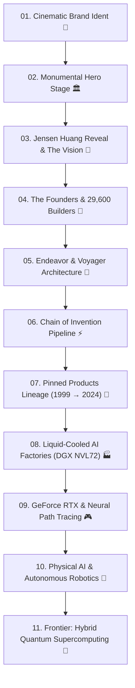

# Beyond Acceleration ⚡
### A Monumental Technology Documentary & Interactive Editorial Experience

[](https://github.com)
[](https://greensock.com)
[](https://github.com)
[](https://www.w3.org/WAI/standards-guidelines/wcag/)
[](https://github.com)


https://hypercompute.vercel.app/

## 🌟 Overview

**Beyond Acceleration** is an elite, museum-grade technology editorial and interactive documentary experience chronicling three decades of specialized parallel computing. 

Rather than a generic landing page or corporate marketing template, this project is engineered as a **cinematic documentary**—tracing the trajectory from an unassuming 1993 Silicon Valley diner booth to the invention of the GPU, the parallel democratization of CUDA, planetary-scale liquid-cooled AI supercomputing factories, and the emerging frontier of physical intelligence.

> *"From graphics, to accelerated computing, to the AI era. Technology changes. The ambition to reinvent computing doesn't."*

---

## 🎬 Narrative Flow



---

## ✨ Key Features & Engineering Highlights

* **🎥 Dedicated Cinematic Brand Ident (5.5s – 6.0s)**
  * A 100% isolated, pure dark forest-graphite canvas (`#060e06`).
  * Authentic white vector logo emerges with soft blur (`0.82 → 1.0`, `12px → 0px`), holds for 1.5 seconds, and slowly lifts into subtle expansion.
  * Zero header or hero text collisions—complete visual stillness before the narrative unfolds.

* **🏛️ Monumental Editorial Typography**
  * Massive fluid typographic hierarchy (`clamp(3.75rem, 9.5vw, 10rem)`) using tight editorial line-heights and disciplined negative space.
  * Clean typographic alignment free of visual clutter or overlapping badges.

* **📜 GSAP ScrollTrigger Storytelling Choreography**
  * **Jensen Huang Reveal (`Slow + Cinematic`)**: Portrait begins partially cropped and scales down (`1.30 → 1.0`) on scrub, triggering line-by-line editorial statement reveals.
  * **People & Labs (`Documentary + Layered`)**: Pinned sequence where archival photos overlap with diagonal `clip-path` transitions, sequentially illuminating core engineering disciplines.
  * **Campus Architecture (`Architectural + Parallax`)**: Architectural zoom (`1.0 → 1.20`) with blueprint reticle grid overlays and dual-speed parallax coordinates.
  * **Hard Progression (`Technical + Precise`)**: Step-by-step pinned scrubber: `PERSON → ENGINEERING → CIRCUIT → CHIP → GPU → COMPUTE → AI FACTORY`.
  * **Inventions Lineage (`Pinned + Transformational`)**: Viewport locks while scrolling cycles through 7 foundational hardware milestones with a live scrub meter.

* **🎨 Strategic Forest-Graphite Color Palette**
  * **45–50% Deep Forest Graphite**: `#0a120a`, `#0e190e`, `#132214`, and `#162817` providing visible tonal separation (never crushed or muddy black).
  * **25–30% NVIDIA Green (`#76B900`)**: Strategic brand signals, card gradients, hairline borders, and active indicators without neon fatigue.
  * **20–25% Pure White & Pale Sage**: High-contrast, fatigue-free editorial typography.

* **🕹️ Interactive Real-Time Ray Tracing Demonstrator**
  * Live toggle comparing 1990s static rasterization (screen-space baked lightmaps) against full RTX Neural Path Tracing with multi-bounce photon reconstruction.

* **🔍 Global Command Palette Index (`Ctrl/Cmd + K`)**
  * Instant keyboard-accessible modal search dialog for rapid navigation across chapters, products, and technical schematics.

---

## 🛠️ Technology Stack & Zero-Dependency Discipline

Built strictly adhering to native web standards and performance best practices:

* **HTML5**: Semantic document outline (`<header>`, `<main>`, `<section>`, `<article>`, `<nav>`, `<footer>`).
* **CSS3**: Fluid clamp typography, custom properties (tokens), CSS Grid, and hardware-accelerated transforms.
* **Vanilla JavaScript (ES6+)**: Modular architecture (`intro.js`, `navigation.js`, `products.js`, `search.js`, `animations.js`, `accessibility.js`).
* **GSAP 3 & ScrollTrigger**: Precision timeline scrubbing with native fallback support.
* **Zero External Build Tools**: Runs directly in any modern browser without npm, webpack, or compiler steps.

---

## 📁 Repository Architecture

```
beyond-acceleration/
├── index.html                   # Master documentary markup & narrative structure
├── assets/
│   ├── brand/
│   │   ├── nvidia_logo_white.svg # Authentic monochrome white logo (Cinematic Ident)
│   │   ├── nvidia_logo.svg       # Official primary logo with signature green eye
│   │   └── nvidia_eye.svg        # Standalone green spiral eye mark
│   ├── icons/                   # Custom SVG navigation & search UI icons
│   ├── images/
│   │   ├── jensen_huang.jpg      # High-resolution official portrait photograph
│   │   ├── jensen_engineers.jpg  # Archival collaborative robotics lab photography
│   │   ├── jensen_chip_signing.jpg # Silicon validation facility archive
│   │   ├── nvidia_headquarters.jpg # Endeavor Santa Clara monumental architecture
│   │   ├── nvidia_campus_aerial.jpg # Silicon Valley campus aerial view
│   │   ├── geforce_256_classic.jpg # Authentic 1999 GeForce 256 NV10 board
│   │   ├── dgx_gb200_rack.jpg    # Liquid-cooled DGX GB200 NVL72 rack
│   │   ├── blackwell_die.svg     # 208B dual-die architecture schematic
│   │   ├── rtx4090.svg           # Ada Lovelace AD102 architecture diagram
│   │   ├── drive_thor.svg        # DRIVE Thor 2,000 TFLOPS centralized SoC
│   │   ├── omniverse_digital_twin.svg # OpenUSD & Isaac Sim digital twin pipeline
│   │   └── research_quantum.svg  # Hybrid quantum-classical computing schematic
│   └── manifest.json            # Asset provenance and metadata verification registry
├── css/
│   ├── tokens.css               # Design tokens (colors, fluid typography, spacings)
│   ├── base.css                 # Accessibility reset, green scrollbars, focus rings
│   ├── layout.css               # Editorial grid, pinned stage layouts, container standards
│   ├── components.css           # Intro overlay, navigation, cards, specs tables
│   ├── animations.css           # Keyframe micro-interactions & pulse states
│   └── responsive.css           # Breakpoints & adaptations down to 320px
└── js/
    ├── main.js                  # Application lifecycle coordinator
    ├── intro.js                 # 5.5s - 6.0s dedicated brand ident controller
    ├── navigation.js            # Reading timeline tracker & telemetry chapter observer
    ├── animations.js            # GSAP ScrollTrigger pinned choreography
    ├── products.js              # Pinned lineage switcher & ray tracing visualizer
    ├── search.js                # Command palette modal dialog (Ctrl+K)
    ├── accessibility.js         # Focus trap and keyboard navigation utilities
    └── vendor/
        ├── gsap.min.js          # GSAP core engine
        └── ScrollTrigger.min.js # ScrollTrigger plugin
```

---

## ⌨️ Keyboard Shortcuts

| Shortcut | Action |
| :--- | :--- |
| `ESC` | Skip cinematic opening ident |
| `Ctrl + K` / `Cmd + K` | Toggle index command palette search |
| `↑` / `↓` | Navigate search results |
| `ENTER` | Jump to selected narrative chapter |
| `TAB` | Accessible focus ring navigation |

---

## ⚖️ License & Attribution

* **Architecture & Code**: MIT License.
* **Photography & Brand Marks**: Used strictly for historical, educational, and editorial tribute purposes. All registered trademarks, logos, and hardware brand marks belong to **NVIDIA Corporation**.

---

<div align="center">
  <sub>Engineered with precision for the next era of accelerated computing.</sub>
</div>
